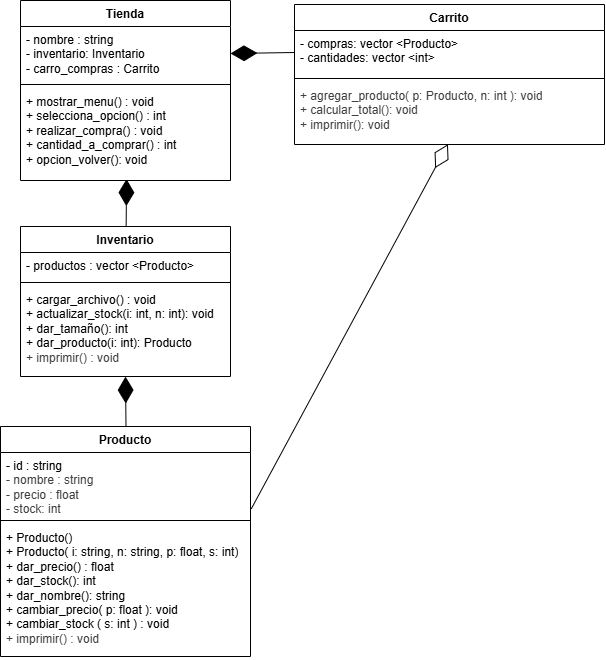

# Tienda Virtual en C++

Aplicación de consola que simula una tienda en línea. Muestra un inventario de productos, permite agregarlos a un carrito indicando la cantidad y calcula el total de la compra.

Proyecto integrador de la materia Pensamiento Computacional Orientado a Objetos del Tecnológico de Monterrey, Campus Estado de México.

## Funcionalidades

1. Seleccionar producto: muestra el inventario (ID, nombre, precio y stock) y permite elegir un producto y la cantidad a comprar
2. Ver el carrito de compras
3. Terminar la compra y mostrar el total a pagar
4. Salir

## Diseño

El programa se organiza en cuatro clases:

- **Tienda:** controla el menú y el flujo de la compra. Contiene un `Inventario` y un `Carrito`.
- **Inventario:** carga los productos desde `inventario.csv`, los almacena y actualiza su stock.
- **Carrito:** guarda los productos seleccionados con sus cantidades y calcula el total.
- **Producto:** representa un artículo con ID, nombre, precio y stock, con sus constructores, getters y setters.

El diseño evolucionó en tres versiones conforme avanzó el proyecto: [primera](diagrama1.png), [segunda](diagrama2.png) y [final](diagrama3.png).

